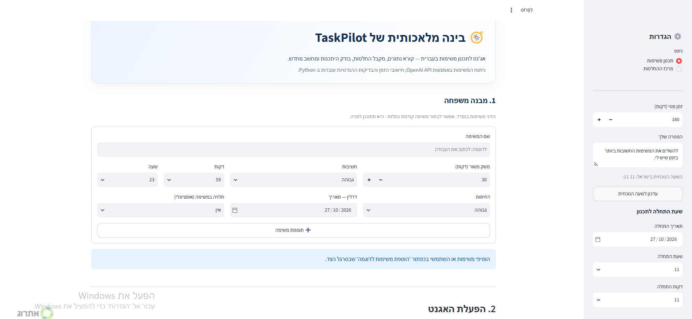
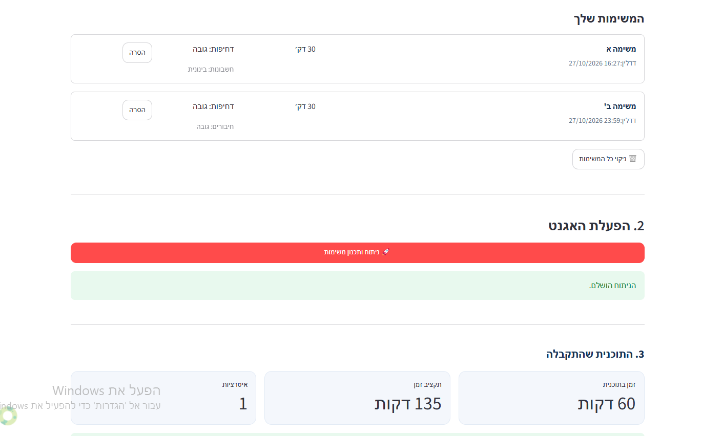
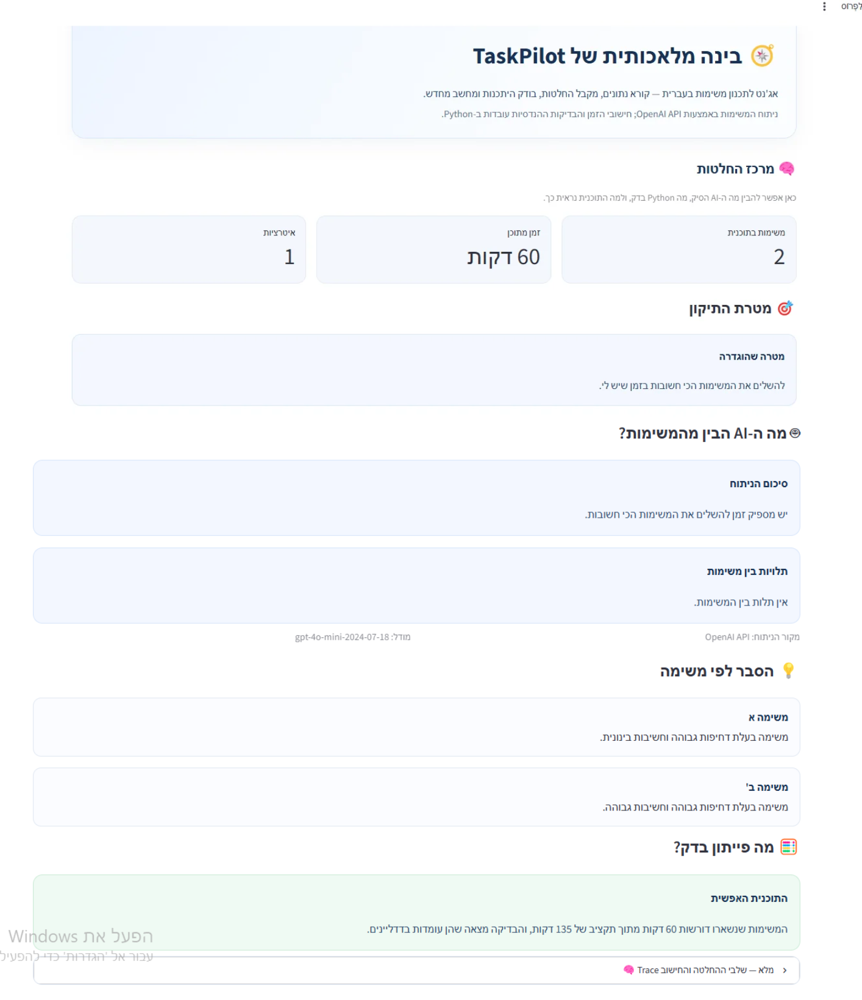
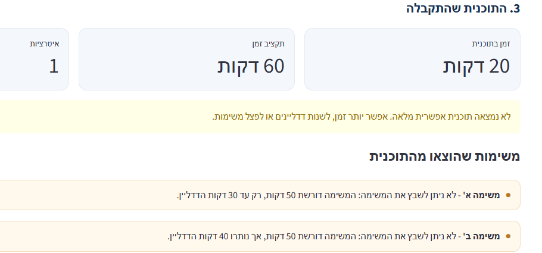
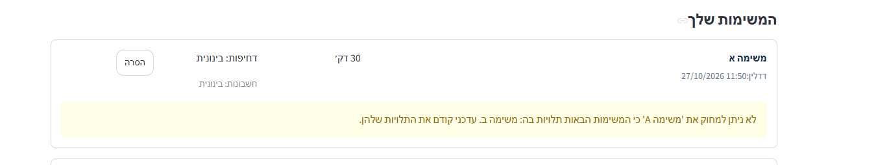

# 🧭 TaskPilot AI

**אג'נט חכם לתכנון משימות וניהול זמן**

TaskPilot AI היא אפליקציית תכנון משימות המשלבת ניתוח באמצעות OpenAI API עם חישובי זמן ובדיקות היתכנות ב־Python. המערכת מנתחת משימות, מתחשבת בדחיפות, בחשיבות, בדדליינים ובתלויות, ומציגה תוכנית עבודה לצד הסברים על החלטותיה.

## 🎯 הבעיה והפתרון

כשיש מספר משימות, מועדי יעד שונים וזמן מוגבל, קשה להחליט מה לבצע קודם ואיך לנצל את הזמן בצורה יעילה.

TaskPilot AI משלבת ניתוח AI עם אלגוריתם תכנון ב־Python כדי לבחור שילוב משימות העומד במגבלות הזמן, הדדליינים והתלויות, ולהסביר מדוע משימות מסוימות לא נכללו בתוכנית.

## 🖥️ צילומי מסך

### 1. מסך ראשי והוספת משימות



### 2. תוכנית העבודה שהתקבלה



### 3. מרכז ההחלטות



### 4. משימות שלא שובצו והסיבות לכך



### 5. הגנה על תלויות במחיקת משימה



## ✨ יכולות מרכזיות

- הוספת משימות עם משך משוער, דחיפות, חשיבות ודדליין.
- הגדרת תקציב זמן, מטרה ושעת התחלה לתכנון.
- התחשבות בתלויות בין משימות.
- זיהוי תלויות חסרות ותלויות מעגליות.
- ניתוח המשימות באמצעות OpenAI API.
- תכנון לוח זמנים ובדיקת היתכנות באמצעות Python.
- הצגת הסיבות לכך שמשימות לא שובצו.
- הצגת Trace המתעד את שלבי ההחלטה והבדיקות.
- הגנה מפני מחיקת משימה שמשימות אחרות תלויות בה.

## 🛠️ טכנולוגיות

- **Python** — חישובי זמן, בדיקות היתכנות ותכנון המשימות.
- **Streamlit** — ממשק המשתמש.
- **OpenAI API** — ניתוח המשימות והפקת הסברים.
- **python-dotenv** — טעינת משתני סביבה מקובץ `.env`.

## ⚙️ התקנה והרצה

### דרישות מקדימות

- Python בגרסה התואמת לתלויות שב־`requirements.txt`.
- מפתח OpenAI API תקין.

### 1. שכפול המאגר

```bash
git clone <REPOSITORY_URL>
cd TaskPilot_AI
```

החליפי את `<REPOSITORY_URL>` בכתובת המאגר לאחר יצירתו ב־GitHub.

### 2. יצירת סביבה וירטואלית

```bash
python -m venv .venv
```

ב־Windows:

```powershell
.venv\Scripts\activate
```

### 3. התקנת התלויות

```bash
pip install -r requirements.txt
```

### 4. הגדרת מפתח API

לצורך הרצה מקומית, צרי קובץ בשם `.env` בתיקיית הפרויקט והוסיפי:

```dotenv
OPENAI_API_KEY=your_api_key_here
```

החליפי את `your_api_key_here` במפתח האישי שלך.

אפשרות נוספת היא ליצור את הקובץ `.streamlit/secrets.toml` ולהגדיר בו:

```toml
OPENAI_API_KEY = "your_api_key_here"
```

הקוד בודק תחילה את Streamlit secrets ולאחר מכן את משתני הסביבה. אם לא נמצא מפתח תקין, ניתוח ותכנון המשימות לא יופעלו.

### 5. הפעלת האפליקציה

```bash
streamlit run app.py
```

לאחר ההפעלה, Streamlit יציג כתובת מקומית לפתיחת האפליקציה בדפדפן.

## 🧠 איך המערכת עובדת?

1. המשתמשת מזינה משימות, דדליינים, דחיפות, חשיבות ותלויות.
2. OpenAI API מנתח את נתוני המשימות ומחזיר סיכום והסברים.
3. Python בודק אילו שילובי משימות עומדים במגבלות הזמן, הדדליינים והתלויות.
4. האפליקציה מציגה את התוכנית שנבחרה, את המשימות שלא שובצו ואת הסיבות לכך.
5. ניתן לפתוח את ה־Trace כדי לראות את שלבי קבלת ההחלטות.

עד 18 משימות, המתכנן בודק שילובים אפשריים באמצעות תכנות דינמי. עבור מספר גדול יותר של משימות, הוא משתמש בשיטת תכנון מהירה לפי סדרי עדיפויות.

## 🔐 אבטחה ופרטיות

- אין להעלות מפתחות API ל־GitHub.
- הקבצים `.env` ו־`.streamlit/secrets.toml` צריכים להישאר מחוץ למאגר.
- בעת ניתוח AI, נתוני המשימות והמטרה נשלחים ל־OpenAI API. אין להזין מידע אישי רגיש.

## 📁 מבנה הפרויקט

```text
TaskPilot_AI/
├── .streamlit/
│   └── secrets.toml
├── screenshots/
│   ├── main-screen.png
│   ├── planned-schedule.png
│   ├── decision-center.png
│   ├── unscheduled-tasks.png
│   └── dependency-protection.png
├── .gitignore
├── app.py
├── README.md
└── requirements.txt
```

## 📌 הערה

TaskPilot AI הוא פרויקט לימודי המדגים שילוב בין מודל שפה לבין לוגיקת תכנון דטרמיניסטית ב־Python. ניתוח ה־AI מספק הסברים, ואילו חישובי הזמן ובדיקות ההיתכנות מתבצעים בקוד.